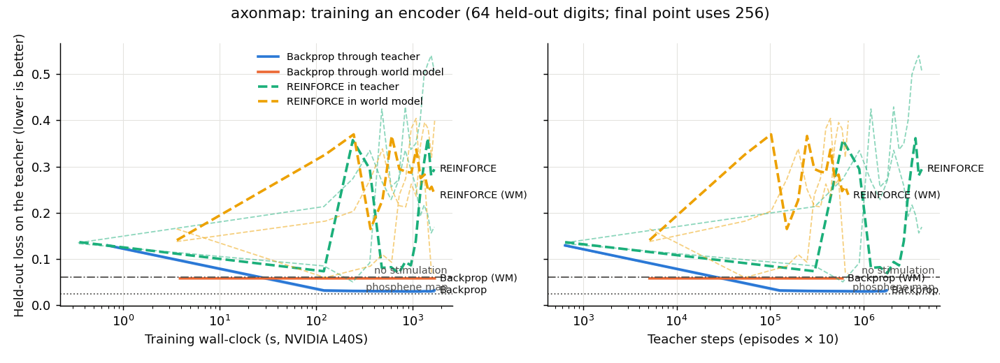
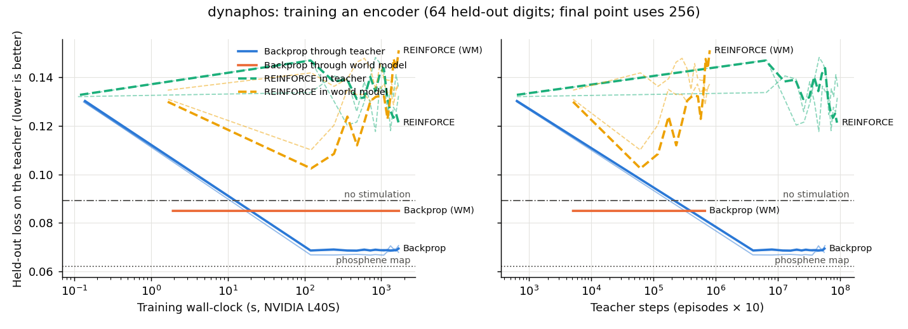

# Imagination results

## axonmap

| Reference (no learning) | Loss | Percept MSE | Charge |
| --- | ---: | ---: | ---: |
| zero | 0.0607 | 0.0607 | 0.000 |
| phosphene_map | 0.0242 | 0.0220 | 0.106 |

| Arm | Seed | Final loss | Percept MSE | Charge | Wall-clock | Teacher steps | Time to phosphene map | Steps to phosphene map | Time to best+10% | Steps to best+10% |
| --- | ---: | ---: | ---: | ---: | ---: | ---: | ---: | ---: | ---: | ---: |
| Backprop through teacher | 0 | 0.0299 | 0.0284 | 0.072 | 1,800 s | 1,882,880 | not reached | not reached | not reached | not reached |
| Backprop through teacher | 1 | 0.0352 | 0.0336 | 0.077 | 1,801 s | 1,883,520 | not reached | not reached | 603 s | 630,400 |
| Backprop through teacher | 2 | 0.0271 | 0.0255 | 0.082 | 1,800 s | 1,875,200 | not reached | not reached | 121 s | 126,720 |
| Backprop through world model | 0 | 0.0607 | 0.0607 | 0.000 | 1,801 s | 628,480 | not reached | not reached | not reached | not reached |
| Backprop through world model | 1 | 0.0607 | 0.0607 | 0.000 | 1,801 s | 622,720 | not reached | not reached | not reached | not reached |
| Backprop through world model | 2 | 0.0607 | 0.0607 | 0.000 | 1,801 s | 627,840 | not reached | not reached | not reached | not reached |
| REINFORCE in teacher | 0 | 0.2665 | 0.2585 | 0.403 | 1,800 s | 4,487,040 | not reached | not reached | not reached | not reached |
| REINFORCE in teacher | 1 | 0.5551 | 0.5428 | 0.617 | 1,800 s | 4,487,040 | not reached | not reached | not reached | not reached |
| REINFORCE in teacher | 2 | 0.1973 | 0.1908 | 0.322 | 1,800 s | 4,492,800 | not reached | not reached | not reached | not reached |
| REINFORCE in world model | 0 | 0.2670 | 0.2586 | 0.418 | 1,800 s | 726,400 | not reached | not reached | not reached | not reached |
| REINFORCE in world model | 1 | 0.3347 | 0.3253 | 0.471 | 1,801 s | 728,320 | not reached | not reached | not reached | not reached |
| REINFORCE in world model | 2 | 0.3548 | 0.3454 | 0.468 | 1,800 s | 727,040 | not reached | not reached | not reached | not reached |

## dynaphos

| Reference (no learning) | Loss | Percept MSE | Charge |
| --- | ---: | ---: | ---: |
| zero | 0.0892 | 0.0892 | 0.000 |
| phosphene_map | 0.0621 | 0.0574 | 0.237 |

| Arm | Seed | Final loss | Percept MSE | Charge | Wall-clock | Teacher steps | Time to phosphene map | Steps to phosphene map | Time to best+10% | Steps to best+10% |
| --- | ---: | ---: | ---: | ---: | ---: | ---: | ---: | ---: | ---: | ---: |
| Backprop through teacher | 0 | 0.0724 | 0.0700 | 0.121 | 1,800 s | 60,558,080 | not reached | not reached | 120 s | 4,022,400 |
| Backprop through teacher | 1 | 0.0708 | 0.0681 | 0.136 | 1,800 s | 59,838,080 | not reached | not reached | 120 s | 3,975,680 |
| Backprop through teacher | 2 | 0.0740 | 0.0714 | 0.131 | 1,800 s | 61,611,520 | not reached | not reached | 120 s | 4,096,000 |
| Backprop through world model | 0 | 0.0892 | 0.0892 | 0.000 | 1,802 s | 716,160 | not reached | not reached | not reached | not reached |
| Backprop through world model | 1 | 0.0892 | 0.0892 | 0.000 | 1,801 s | 712,320 | not reached | not reached | not reached | not reached |
| Backprop through world model | 2 | 0.0892 | 0.0892 | 0.000 | 1,801 s | 713,600 | not reached | not reached | not reached | not reached |
| REINFORCE in teacher | 0 | 0.1347 | 0.1237 | 0.548 | 1,800 s | 96,236,800 | not reached | not reached | not reached | not reached |
| REINFORCE in teacher | 1 | 0.1471 | 0.1365 | 0.529 | 1,800 s | 99,250,560 | not reached | not reached | not reached | not reached |
| REINFORCE in teacher | 2 | 0.1417 | 0.1302 | 0.574 | 1,800 s | 98,000,000 | not reached | not reached | not reached | not reached |
| REINFORCE in world model | 0 | 0.1570 | 0.1446 | 0.617 | 1,801 s | 858,880 | not reached | not reached | not reached | not reached |
| REINFORCE in world model | 1 | 0.1457 | 0.1368 | 0.447 | 1,801 s | 856,320 | not reached | not reached | not reached | not reached |
| REINFORCE in world model | 2 | 0.1365 | 0.1268 | 0.483 | 1,801 s | 847,360 | not reached | not reached | not reached | not reached |
