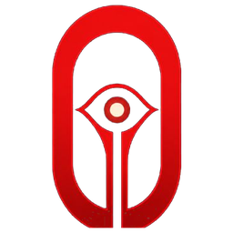

  

# Sentionaut

[Home](index.md) · [Getting started](getting-started.md) · [User guide](user-guide.md) · [Nomenclature](nomenclature.md) · [Models](models/index.md) · [References](references.md)

Sentionaut is a modular, GPU-native PyTorch framework for **prosthetic vision**.
It reimplements pulse2percept's retinal and cortical phosphene models as
differentiable Torch ports, wraps them in a shared world-model interface
`f(s_t, a_t) → s_{t+1}`, and trains a learned transformer on the resulting
transitions.

Where [pulse2percept](https://pulse2percept.readthedocs.io) is the CPU reference
simulator, Sentionaut is the differentiable, world-model-facing layer on top of
the same physics.

## Where to start

| If you want to… | Read |
| --- | --- |
| Compute your first percept | [Getting started](getting-started.md) |
| See what each model predicts | [Stimulation demos](models/demos.md) |
| Generate data, train, reproduce results | [User guide](user-guide.md) |
| Pick a model and its paper | [Model catalog](models/index.md) |
| Work on closed-loop stimulation | [Canonical formulation](neurostim-formulation.md) |

Source code: [github.com/ascientist/sentionaut](https://github.com/ascientist/sentionaut).

## Components

Three axes swap independently via a `Config`:

- **Implant** — electrode geometry and pose (retinal: Argus II, Alpha IMS/AMS,
  PRIMA, grid; cortical: Orion, Cortivis, ICVP, Neuralink)
- **Topography** — visual-field ↔ tissue map (Jansonius axon map; Polimeni 2006;
  optional Neuropythy MRI)
- **Percept model** — phosphene physics (`axonmap`, `scoreboard`, `dynaphos`)

Implants and topography are supporting geometry. The percept models (and the
learned world model) are classified by **modality** — see
[Nomenclature](nomenclature.md).

## Models at a glance

| Model | Modality | Tissue | Paper |
| --- | --- | --- | --- |
| [Axon map](models/axonmap.md) | `stim2vision` | retinal | Granley & Beyeler 2021 |
| [Axon-map world model](models/axonmap-world.md) | `stim2vision` | retinal | distilled from axon map |
| [Scoreboard](models/scoreboard.md) | `stim2vision` | cortical | Beyeler et al. 2019 |
| [Dynaphos](models/dynaphos.md) | `stim2vision` | cortical | van der Grinten et al. 2024 |
| [World model](models/world-model.md) | `stim2vision` | multi | learned (no paper) |

## Encoders and forward models

A prosthesis pairs an **encoder** (a signal in some modality → stimulation,
`vision2stim`, `sound2stim`) with a **forward model** (stimulation → percept,
`stim2vision`). [Architecture](architecture.md) defines both halves and how
they connect. [Imagination](imagination.md) trains a vision encoder by
backpropagating through a learned world model fitted online to the axon map
or Dynaphos, after SuperMimic (Liao et al. 2026), and compares it with
backpropagating through the analytical model itself.
[Patient data](patient-data.md) fits the axon map to the phosphene drawings of
Argus II users.

## Closed-loop control

The [canonical formulation](neurostim-formulation.md) states the problem
precisely: adaptive tracking over a population of random, slowly drifting,
partially observed dynamical systems. It covers the patient, drift and
fast neural state, and the image and patient generalisation axes.
[NeuroStim](neurostim.md) is a toy constrained POMDP for closed-loop
neurostimulation: 3 latents, 4 overlapping electrodes, an unknown per-patient
recruitment matrix, adaptation and safety constraints, plus baselines from
bandit to PPO-Lagrangian and supervised DAgger imitation.
[NeuroStim-Percept](neurostim-percept.md) turns the target into an MNIST
image. It learns stimulation through a learned world model with a
reconstruction loss, with no RL.

All current percept models map electrode stimulation to a predicted visual
percept (`stim2vision`). Browse the [catalog](models/index.md) for details and
citations.
